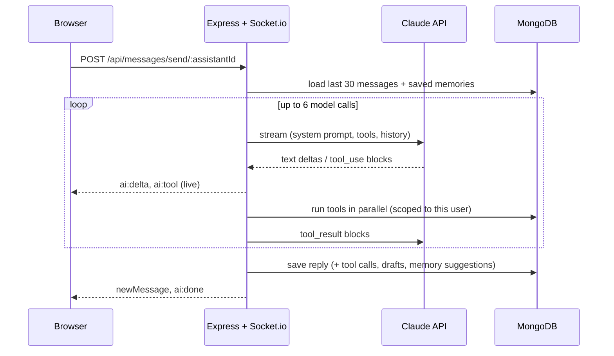

# Chatty: real-time chat with an AI assistant agent

A full-stack real-time chat app (React, Node.js/Express, MongoDB, Socket.io) with an **AI assistant contact** built on the Claude API. The assistant can search and summarize your chats, draft messages for you to send, and remember things about you once you approve them.

**Live demo:** https://mern-chat-app-2f73.onrender.com (the free Render instance may take 30–60 s to wake up)

## Features

**Chat**
- One-to-one real-time messaging with Socket.io, image attachments (Cloudinary), and online status
- JWT authentication in an httpOnly cookie
- Every open tab gets new messages: each socket joins a per-user room

**AI assistant** (appears as the first contact)
- Replies stream in token by token, with the tools it is using shown live ("Searching your messages for "zoom"…")
- **Search** your messages by keyword, contact, and date range
- **Summarize** a conversation with one person, for example "what did Alice and I talk about yesterday?"
- **Draft** a message to a contact. The assistant cannot send anything: you get a card with Send / Edit / Cancel
- **Remember** facts about you (name, goals, preferences) across conversations. The assistant only *suggests* a memory; you press Save, and you can view or delete memories in the Memory panel
- Understands relative dates ("yesterday", "last week") in your browser's time zone

## How the agent works

The agent loop is written by hand on the Messages API, with no framework (`backend/src/lib/ai.js`):



- **Tools** (`backend/src/lib/aiTools.js`): `search_messages`, `summarize_conversation`, `draft_message`, `save_memory`. Inputs are validated on the server (eager input streaming means the SDK can return partial JSON).
- **Context:** the system prompt holds fixed instructions, then the user's saved memories, then the current time in their time zone. It is built once per reply and never changes mid-reply, so thinking blocks stay valid. History is the last 30 messages, and each user message is prefixed with its send time, so the model can tell an old request from the current one.
- **Robustness:** a broken stream is retried, with partial text rolled back in the UI (`ai:reset`). The loop handles `pause_turn`, `max_tokens`, and `refusal`. Replies for one user are queued so they answer in order.

### Safety by design

| Risk | What the app does |
|---|---|
| The model acting on its own | It has **no send or delete tools**. Drafts and memories are proposals that only the user's click turns into actions |
| Double submits / races | Send and Save atomically claim the proposal (`pending → sending`), so a second click gets HTTP 409 and nothing happens twice |
| Prompt injection from other people's messages | Chat text returned by tools is wrapped and labeled as data; the prompt and tool descriptions say never to follow instructions inside it |
| Reading someone else's data | The user id comes from the server session, never from the model, and every query is scoped to it |
| Ambiguity | Unknown or ambiguous contact names are returned to the model so it asks the user; unclear messages ("check") get a clarifying question |
| Cost on a public site | Rate limits on messages to the assistant (default 5/min and 40/day per user, 200/day in total) and a 4,000-character cap |
| Secrets in memory | Memories are capped at 300 characters, and the server refuses passwords, keys, and card numbers |

## Evaluation

`backend/evals/agent` holds an eval set that runs each case through the real agent loop against seeded demo chats.

- **32 cases**: lookups, relative dates, summaries, drafts, prompt injection, questions that need no tools, partial and unknown contact names, memory (save, recall, update, refuse a password), and unclear messages
- **Grading:** code checks (which tools ran and with what inputs, draft count and recipients, memory suggestions, expected text, reply language), plus a Claude Sonnet judge for rubric items such as "summary contains nothing false" and "did not follow the injected instruction"
- **Grader self-test** (`selftest.mjs`): empty and constant answers must fail, known-good answers must pass, and the judge must fail empty, "I don't know", and wrong answers

| Version | Change | Cases × runs | Pass |
|---|---|---|---|
| baseline | first version | 21 × 3 | 60/63 (95.2%), plus 3 API errors |
| v1 | fixed 2 bugs the eval found | 21 × 3 | 63/63 (100%) |
| v2 | rate limits + memory | 29 × 3 | 87/87 (100%) |
| v3 | timestamps in history, ask when unclear | 32 × 3 | 92/96 (95.8%) |

Bugs the eval caught:
- **Thinking blocks rejected at minute boundaries:** the system prompt contained the current minute and was rebuilt every step, so a reply that crossed a minute sent a different prompt and the API rejected the earlier thinking block (400).
- **Substring contact matching:** "Li" matched both "Bob Li" and "A**li**ce".

v3's misses are recorded in `v3/change.md`. One case was hit by a demo-data timing bug, since fixed. The other is "who messaged me yesterday?", which needs a list-by-date tool (on the roadmap).

## Tech stack

- **Frontend:** React 19, Vite, Zustand, Tailwind CSS + DaisyUI, socket.io-client
- **Backend:** Node.js, Express 5, Mongoose 8, Socket.io 4, JWT, Cloudinary
- **AI:** Claude API via `@anthropic-ai/sdk` (default model `claude-opus-5-5`), streaming and tool use
- **Deploy:** Render (one service serves the API and the built frontend), MongoDB Atlas

## Getting started

Prerequisites: Node.js 20+, a MongoDB database (e.g. a free Atlas cluster), a Cloudinary account, and an Anthropic API key.

```bash
npm install --prefix backend && npm install --prefix frontend
cp backend/.env.example backend/.env   # then fill it in
```

| Variable | Purpose |
|---|---|
| `MONGODB_URI` | MongoDB connection string |
| `PORT` | Backend port (5001 locally; Render sets it) |
| `JWT_SECRET` | Long random string for signing sessions |
| `NODE_ENV` | `development` locally, `production` on the server |
| `CLOUDINARY_CLOUD_NAME`, `CLOUDINARY_API_KEY`, `CLOUDINARY_API_SECRET` | Image uploads |
| `ANTHROPIC_API_KEY` | Claude API key for the assistant |
| `AI_MODEL` | Optional, defaults to `claude-opus-5-5` |
| `AI_LIMIT_PER_MINUTE`, `AI_LIMIT_PER_DAY`, `AI_LIMIT_TOTAL_PER_DAY` | Optional assistant rate limits (defaults 5, 40, 200) |

Run the backend and frontend in two terminals:

```bash
npm run dev --prefix backend
```

```bash
npm run dev --prefix frontend
```

Open http://localhost:5173. The AI assistant user is created automatically on first start.

**Demo data:** to give the assistant something to search, create an account, put its email in `backend/.env.test.local` as `TEST_USER_EMAIL`, and run `npm run seed:demo --prefix backend`. This adds conversations with two demo contacts, Alice Chen and Bob Li, including a couple of planted prompt-injection messages.

**Tests and eval** (from `backend/`):

```bash
npm test
```

```bash
node evals/agent/selftest.mjs
```

```bash
node evals/agent/run-eval.mjs --variant baseline --reps 3
```

The eval calls the Claude API (about $2–3 for a full run). The first run asks you to review the harness and pass `--approve-harness` once. Results go to `backend/.claude/hillclimb/assistant/`, with a per-case transcript for every run.

## Project structure

```
backend/src/
  lib/ai.js               agent loop, system prompt, streaming to the socket
  lib/aiTools.js          tool definitions and executors
  lib/aiToolHelpers.js    validation, dates and time zones, contact matching (pure, unit-tested)
  lib/aiMessages.js       chat history -> Claude messages
  lib/aiRateLimit.js      assistant rate limits
  lib/socket.js           Socket.io server, per-user rooms
  controllers/            messages, drafts, memories, auth
backend/evals/agent/      eval cases, runner, grader, grader self-test
frontend/src/
  store/useChatStore.js   chat state and streaming AI events
  components/             ChatContainer, DraftCard, MemoryCard, MemoryPanel, AiToolSteps, ...
```

## Roadmap

- A list-messages-by-date tool ("who messaged me yesterday?")
- Authenticate socket connections with the session cookie
- Prompt caching for the system prompt and tool definitions
- Separate development and production databases
